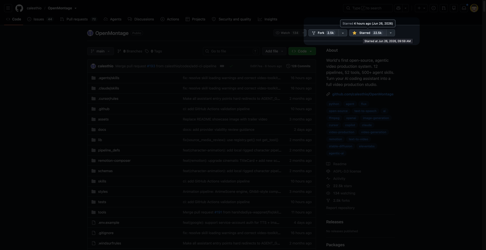

# GitHub Starred At

A lightweight Chrome (Manifest V3) extension that surfaces the exact moment you starred a repository on GitHub. It overlays a quiet hover tooltip on the star button of any repository page, and adds a small "Starred at" badge to each repository on your `/?tab=stars` list.



## What it does

- On a repository page, hover the Star button to see when you starred it. The tooltip can show a relative time (e.g. "2 years ago"), an absolute date (e.g. "Jun 26, 2024"), or both.
- On your [GitHub Stars tab](https://github.com/?tab=stars), a "Starred at" badge is inserted next to each repository's last-updated timestamp.
- On GitHub's [Trending repositories](https://github.com/trending), a "Starred at" badge appears after the "Built by" authors for repositories you have starred. Hovering the Starred button also shows the time.
- Syncs your full list of starred repositories in the background and caches it locally, so lookups are instant and the GitHub API is not hit on every page view.
- Auto-syncs on a configurable interval (default: every 12 hours), and you can trigger a manual sync at any time.
- All data is stored locally in `chrome.storage.local`. Your token never leaves the extension except for direct calls to the GitHub API.

## Prerequisites

- Chrome 114 or later (Manifest V3 is required).
- A GitHub **fine-grained personal access token** with the **Starring: Read-only** permission. Create one at [github.com/settings/personal-access-tokens](https://github.com/settings/personal-access-tokens).

## Installation (from source)

1. Clone or download this repository.
2. Open `chrome://extensions/` in Chrome.
3. Enable **Developer mode** (top right).
4. Click **Load unpacked** and select the project root (the directory that contains `manifest.json`).
5. Pin **GitHub Starred At** to the toolbar for easy access.

## Usage

1. Click the extension icon in the Chrome toolbar to open the options page.
2. Paste your GitHub token into the **GitHub token** field.
3. (Optional) Adjust the **Display** settings:
   - **Auto-sync interval** — how often the extension refreshes your starred list, in hours (1–168).
   - **Relative time** — show "x years ago" style labels.
   - **Absolute date** — show the calendar date.
4. Click **Save settings**.
5. Click **Sync now** to perform the initial sync. The status pill will show "Synced" once it completes, along with the number of indexed repositories and the last sync time.
6. Visit any repository page on GitHub and hover the Star button — the "Starred at" tooltip will appear.
7. Visit `https://github.com/?tab=stars` to see the "Starred at" badge next to each repo on your stars list.
8. Visit `https://github.com/trending` to see the badge after the "Built by" authors for trending repositories you have starred. Hover over a repository's **Starred** button to see its time in a tooltip.

The extension also reacts to GitHub's client-side navigation, so switching between repositories without a full page reload still updates the tooltip.

## Permissions explained

- `alarms` — schedules the periodic background sync.
- `storage` — caches your token, options, and the starred-repositories map locally.
- `https://github.com/*` and `https://api.github.com/*` — runs the content script on GitHub and calls the GitHub REST API to fetch your starred list.

## Project structure

```
manifest.json          # Extension manifest (MV3)
src/
  background.js        # Service worker: token storage, sync logic, message routing
  content.js           # Content script: tooltip and stars-list badge injection
  storage.js           # Shared storage helpers and default options
  options.html         # Options / popup page markup
  options.css          # Options page styling
  options.js           # Options page behavior
```

## Privacy

- The extension only reads your starred repositories via the GitHub API. It does not read your code, issues, pull requests, or any other data.
- Your token and cached data are stored in `chrome.storage.local` on your machine and are not transmitted to any third party.
- No analytics, no telemetry, no remote backend.

## License

MIT.
